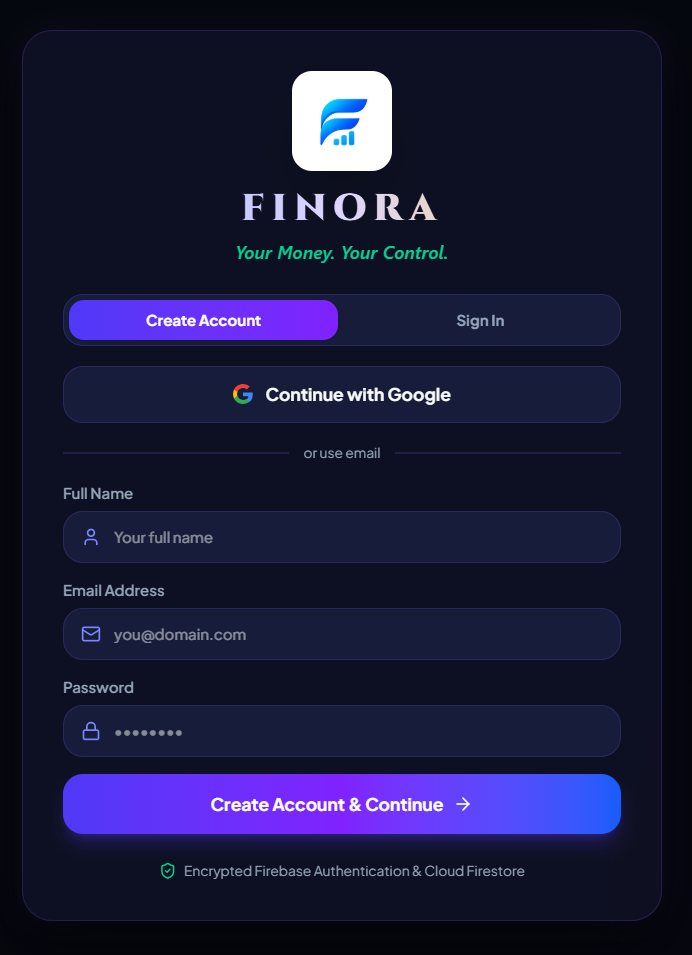
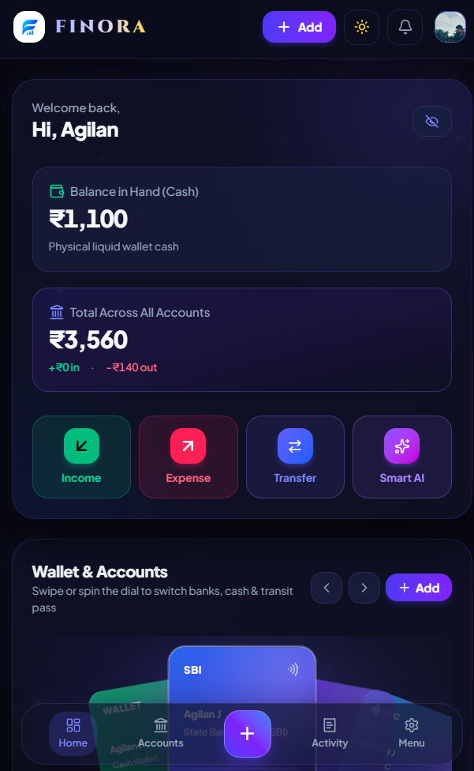
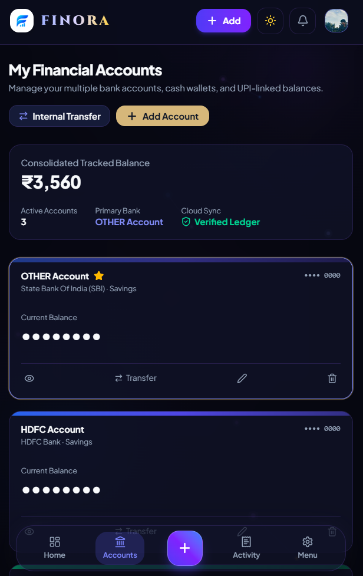
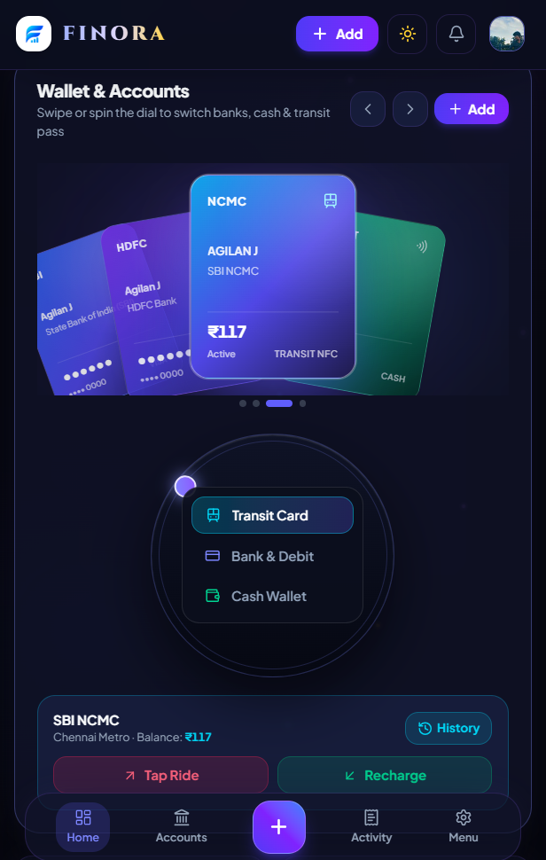
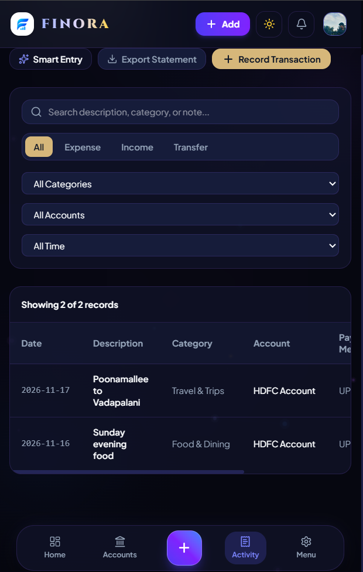
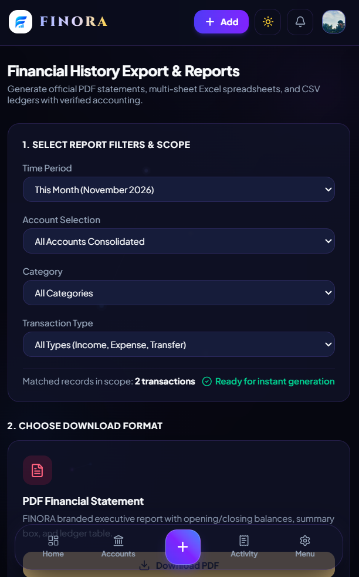
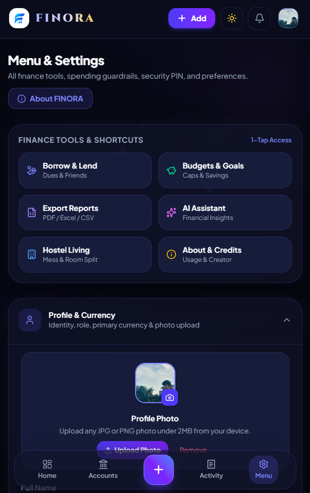

# FINORA – Your Money. Your Control. 💰

\<p align="center">
&#x20; \
\</p>

\<h3 align="center">A Smarter Way to Manage Your Money\</h3>

\<p align="center">   A modern, intelligent and responsive personal finance management platform designed to help you track expenses, manage multiple bank accounts, organize your finances and take control of your money. \</p>

\<p align="center">   \<a href="[https://finoraa-money.vercel.app/](https://finoraa-money.vercel.app/)">\<strong>🌐 Live Demo\</strong>\</a>   ·   \<a href="#-features">\<strong>Explore Features\</strong>\</a>   ·   \<a href="#-installation-and-setup">\<strong>Installation\</strong>\</a> \</p>


<p align="center">
  
</p>

<h3 align="center">A Smarter Way to Manage Your Money</h3>

<p align="center">
  A modern, intelligent, and responsive personal finance management platform designed to help you track expenses, manage multiple bank accounts, organize your finances, and take control of your money.
</p>

<p align="center">
  <a href="https://finoraa-money.vercel.app/">
    <strong>🌐 Live Demo</strong>
  </a>
  &nbsp;·&nbsp;
  <a href="#-features">
    <strong>✨ Explore Features</strong>
  </a>
  &nbsp;·&nbsp;
  <a href="#-installation-and-setup">
    <strong>⚙️ Installation</strong>
  </a>
</p>
---

## 🚀 About FINORA

**FINORA** is a personal finance management web application built to simplify everyday money management.

Managing money across multiple bank accounts, tracking daily expenses, monitoring savings and keeping track of borrowed or lent money can become difficult without a centralized system.

FINORA brings these financial activities together in one place through a clean, intuitive and responsive interface.

Whether you are a college student managing pocket money, a hostel resident sharing expenses with friends or a working professional tracking monthly finances, FINORA helps you understand where your money goes and how you manage it.

**Your Money. Your Control.**

## ✨ Features

### 📊 1. Financial Dashboard

- Get a quick overview of your financial position.
- Monitor total tracked balance.
- View monthly income and expenses.
- Track monthly savings.
- Visualize financial activities.
- Access recent transactions and financial summaries.

### 🏦 2. Multiple Bank Account Management

- Add and manage multiple bank accounts.
- Maintain individual account balances.
- Organize savings accounts and cash wallets.
- View account-specific transaction history.
- Transfer money between your own accounts.
- Track balances across different accounts.
- Manage account details from one centralized dashboard.

### 💳 3. Debit Card Account Carousel

- Display individual bank accounts as debit-card-style visual cards.
- Browse accounts through a horizontal carousel.
- View account names and tracked balances.
- Enjoy a visually organized digital banking experience.
- Easily navigate between multiple accounts.

### 💰 4. Income and Expense Tracking

- Record daily income and expenses.
- Categorize financial transactions.
- Add transaction descriptions and dates.
- View transaction history.
- Monitor spending activities.
- Filter and manage financial records.

### 🤝 5. Borrowing and Lending Management

- Track money borrowed from others.
- Record money lent to friends.
- Monitor outstanding balances.
- Track repayment activities.
- Manage borrowing and lending records in one place.

### 👥 6. Group Expense Management

- Create and manage expense groups.
- Organize shared expenses.
- Track group financial activities.
- Manage roommate and friends' expenses.

### 📈 7. Budget Management

- Create personal spending budgets.
- Organize budgets by category.
- Monitor spending against budget limits.
- Understand monthly spending patterns.

### 🎯 8. Savings Goals

- Create personal savings goals.
- Set target amounts.
- Monitor savings progress.
- Track progress towards financial goals.

### 📅 9. Financial Calendar

- Organize important financial activities.
- Track upcoming financial commitments.
- Manage financial reminders.
- View financial activities through a calendar interface.

### 🏠 10. Hostel Expense Management

- Organize hostel-related expenses.
- Track everyday hostel spending.
- Manage shared hostel financial activities.

### 💳 11. Virtual Wallet

- Organize personal cards in one place.
- Manage visual card representations.
- Maintain a centralized digital wallet interface.

### 📊 12. Financial Analytics

- Visualize income and expenses.
- Understand spending patterns.
- Review financial summaries.
- Analyze personal financial activities through charts.

### 📄 13. Financial Reports and Export

- Generate financial reports.
- Export transaction information.
- Download reports in PDF format.
- Export structured financial data to Excel.
- Maintain organized financial records.

### 🤖 14. AI-Powered Financial Assistant

- Interact with an AI-powered financial assistant.
- Get assistance with financial activities.
- Use AI to understand transaction-related information.

### ⚡ 15. Smart Transaction Entry

- Simplify transaction entry using AI.
- Interpret natural-language transaction descriptions.
- Reduce manual data entry.

### 🎨 16. Dark and Light Themes

- Premium dark theme.
- Clean light theme.
- Consistent interface across application sections.
- Personalized theme preferences.

### 🔐 17. Authentication and User Settings

- Google authentication through Firebase.
- User-specific financial data.
- Profile and application settings.
- Personalized application preferences.

---

## 🖥️ Screenshots

Explore the FINORA interface.

### Signup page




### Dashboard




### Account Management




### Debit Card Carousel




### Transactions




### Reports and Financial Management




### Settings and features




---

## 🛠️ Technology Stack

| Technology              | Purpose                           |
| ----------------------- | --------------------------------- |
| React 19                | Frontend development              |
| TypeScript              | Type-safe development             |
| Vite 8                  | Development server and build tool |
| Tailwind CSS 4          | Styling and responsive design     |
| Firebase Authentication | User authentication               |
| Firebase Firestore      | Cloud database                    |
| Google Gemini AI        | AI-powered features               |
| Node.js                 | Backend runtime                   |
| Express.js              | Backend API                       |
| Lucide React            | Icons                             |
| Motion                  | UI animations                     |
| jsPDF                   | PDF report generation             |
| SheetJS (XLSX)          | Excel export                      |

---

## 🏗️ Application Architecture

FINORA uses a modern frontend and backend architecture.

```text
                    FINORA
                       |
          +------------+------------+
          |                         |
       Frontend                  Backend
          |                         |
     React + Vite              Node.js + Express
          |                         |
     TypeScript               REST API Endpoints
          |                         |
     Tailwind CSS              Google Gemini AI
          |
          +-------------------------+
          |
      Firebase
          |
    +-----+------+
    |            |
 Authentication Firestore
```

### Backend API Endpoints

The application includes the following backend routes:

| Endpoint                    | Purpose                        |
| --------------------------- | ------------------------------ |
| `/api/health`               | Backend health check           |
| `/api/ai/parse-transaction` | AI-powered transaction parsing |
| `/api/ai/assistant`         | AI financial assistant         |
| `/api/feedback`             | Feedback submission            |

---

## 📂 Project Structure

```text
FINORA/
│
├── public/
│   └── assets/
│       └── aistudio/
│
├── src/
│   ├── components/
│   │   ├── accounts/
│   │   ├── analytics/
│   │   ├── ai/
│   │   ├── auth/
│   │   ├── budgets/
│   │   ├── calendar/
│   │   ├── cards/
│   │   ├── common/
│   │   ├── dashboard/
│   │   ├── goals/
│   │   ├── groups/
│   │   ├── hostel/
│   │   ├── layout/
│   │   ├── loans/
│   │   ├── reports/
│   │   ├── settings/
│   │   ├── subscriptions/
│   │   ├── transactions/
│   │   └── wallet/
│   │
│   ├── config/
│   ├── context/
│   ├── types/
│   ├── utils/
│   ├── App.tsx
│   ├── firebase.ts
│   ├── index.css
│   └── main.tsx
│
├── .env.example
├── .gitignore
├── firebase-applet-config.json
├── firestore.rules
├── index.html
├── package.json
├── server.ts
├── tsconfig.json
└── vite.config.ts
```

---

## ⚙️ Installation and Setup

Follow these instructions to run FINORA locally.

### Prerequisites

Make sure you have installed:

- Node.js (compatible with your project dependencies; Node.js 22 or later recommended).
- npm.
- Git.
- A Firebase project.
- A Google Gemini API key.

### 1. Clone the repository

```bash
git clone https://github.com/YOUR_USERNAME/finora.git
```

Navigate into the project directory:

```bash
cd finora
```

### 2. Install dependencies

```bash
npm install
```

### 3. Configure environment variables

Create a `.env` file in the project root.

Add your Gemini API key:

```env
GEMINI_API_KEY=your_gemini_api_key
```

Obtain your API key from:

[https://aistudio.google.com/apikey](https://aistudio.google.com/apikey)

**Important:** Never expose your Gemini API key in frontend code or commit your actual `.env` file to GitHub.

### 4. Configure Firebase

Make sure your Firebase project is configured correctly.

The application uses Firebase Authentication and Cloud Firestore.

Verify:

- Firebase project configuration.
- Google authentication provider.
- Firestore database configuration.
- Firestore security rules.
- Authorized authentication domains.

### 5. Start the development server

```bash
npm run dev
```

Open the local application using the URL displayed in your terminal.

### 6. Build for production

```bash
npm run build
```

The production build will be generated in the `dist/` directory.

### 7. Run TypeScript checks

```bash
npm run lint
```

---

## 🌐 Live Deployment

FINORA is deployed using Vercel.

**Live Application:**

[https://finoraa-money.vercel.app/](https://finoraa-money.vercel.app/)

The application uses:

- Vercel for deployment.
- Firebase for authentication and database services.
- Google Gemini API for AI-powered functionality.

---

## 🔒 Security and Privacy

Financial data requires careful handling.

FINORA uses Firebase Authentication and Firestore to manage user authentication and financial information.

Security considerations:

- Keep API secrets on the backend.
- Apply Firestore security rules.
- Restrict access to authenticated users' own records.
- Never store bank passwords, UPI PINs, OTPs or CVVs.
- Avoid uploading unmasked payment card information.
- Validate financial operations and user inputs.

Do not use FINORA as a payment-processing application. Account balances are intended for personal tracking, not as verified live bank balances.

---

## 🎯 Project Goals

FINORA aims to make personal finance management simpler, more organized and accessible.

The main goals are:

- Simplify everyday money management.
- Encourage better financial habits.
- Help students manage pocket money.
- Make multiple account tracking easier.
- Improve awareness of spending patterns.
- Organize borrowing and lending.
- Provide a centralized personal finance experience.

---

## 🚀 Future Improvements

Potential areas for future development:

- Progressive Web App (PWA) support.
- Enhanced financial insights.
- Advanced recurring transaction management.
- More detailed financial reports.
- Additional account visualization options.
- Improved mobile experience.
- Optional notification integrations.
- Additional language support.
- Secure bank-data integrations where officially supported.

---

## 👨‍💻 Developer

**Developed by Agilan J**

B.E. Cybersecurity Student | Web Developer | Technology Enthusiast

- GitHub: [https://github.com/agilanj](https://github.com/agilanj)
- Portfolio: [https://github.com/agilanj/agilan-portfolio](https://github.com/agilanj/agilan-portfolio)

---

## 📜 License

This project is currently available for learning and portfolio demonstration.

Add an appropriate open-source licence before permitting reuse or redistribution.

---

\<p align="center">
&#x20; \<strong>FINORA – Your Money. Your Control.\</strong>
&#x20; \<br />
&#x20; Built to make everyday financial management simpler.
\</p>
